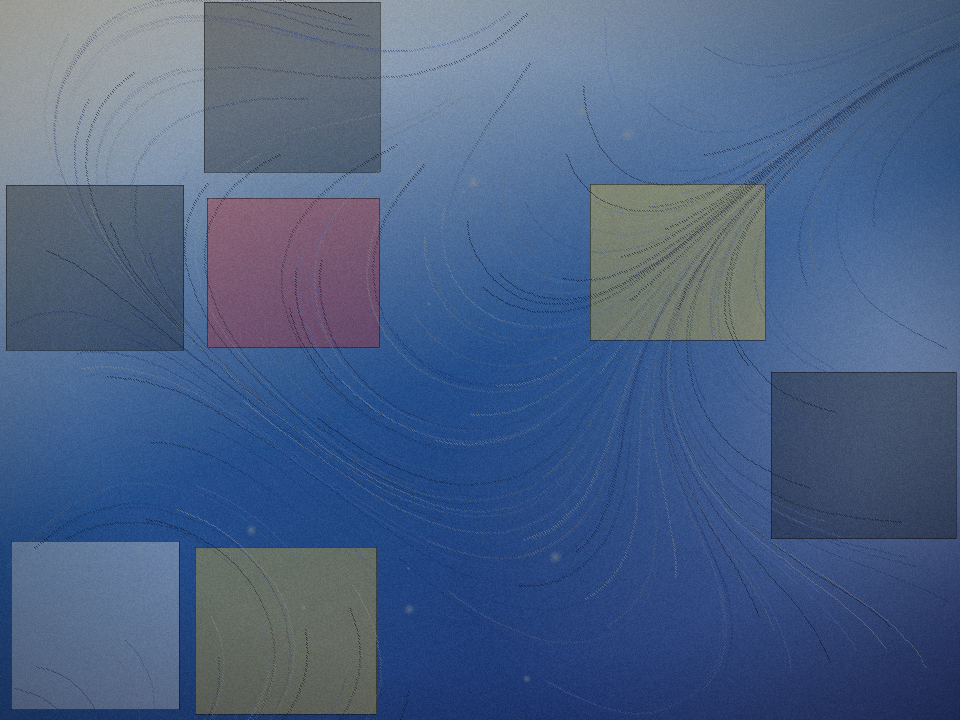

# PaletteMash — the AI art-curator mashup studio

**Pick 2–3 artworks. PaletteMash curates their colours into a brand-new
generative piece — and shows its work.**

Museums mash up eras in a single gallery wall; PaletteMash does it inside a
single canvas. You choose two or three source artworks, the tool extracts each
one's colour palette, assigns each palette a curatorial *role* — **atmosphere,
movement, structure** — and composes an original generative artwork from those
roles. Every piece comes with a visible **curation statement**: which sources
were used, which exact colours came from each, and how they were recomposed.
Curation is usually invisible labour; here it is the interface.

Built for **InnovArt 2027: Art and Technology Hack Day** (Devpost).



## The art-ethics design (read this first)

An AI art tool at an art hackathon has to be honest about its material. So:

- **No scraped art. No copyrighted art. No artist's image file is used at any
  step.** The three built-in sources are *original procedural renderings
  generated by this project's own code*, inspired by public-domain masters —
  Van Gogh (d. 1890), Hokusai (d. 1849), Mondrian (d. 1944). Full credits and
  the precise meaning of "inspired by" are in [SOURCES.md](SOURCES.md).
- **Only colours travel.** The output contains zero pixels from any source —
  palettes are extracted, then an original composition is painted from them.
- **Everything is local.** The web app runs entirely in your browser; the
  optional "your own photo" source is palette-extracted on-device and never
  uploaded.

## How it works

1. **Procedural sources** (`src/blend.js`): three seeded painters render
   original studies — spiral flow strokes and star orbs (Swirl Night), layered
   wave arcs with foam spray (Great Wave), a primary-colour grid (Grid
   Composition).
2. **Palette extraction**: colour quantisation (5 bits/channel histograms,
   distance-filtered) pulls the 6 most characteristic colours per source,
   with their shares.
3. **Curatorial composition** (`renderMashup`):
   - *Atmosphere* — a diagonal gradient wash + soft light pools from palette 2;
   - *Structure* (3-source mode) — translucent geometric shards from palette 3;
   - *Movement* — a seeded flow field of ~200 ribbons painted in palette 1,
     steered by the turbulence slider, plus accent orbs in its lightest colour;
   - film grain + vignette to finish.
4. **Curation statement**: generated alongside the image, naming each source,
   its role, its top colours as hex values, the seed, and the method.
5. **Export**: one click downloads a 960×720 PNG.

## Run it

Zero dependencies. Node ≥ 18 (or any static file server / open the file).

```bash
node server.js        # → http://localhost:4173
```

Headless check + sample outputs (also regenerates everything in `output/`):

```bash
node smoke-test.js    # paints sources, blends 2- and 3-source mashups, PASS/FAIL
```

## Files

| Path | What |
|---|---|
| `index.html`, `app.js` | Web UI: source picker, turbulence/seed direction, canvas, curation statement, PNG export, local-photo palette source |
| `src/blend.js` | Core library (Node + browser): procedural painters, palette extraction, mashup renderer, curation statement, PNG encoder (built-in zlib only) |
| `server.js` | Zero-dependency static server |
| `smoke-test.js` | Headless end-to-end test with real PNG outputs |
| `output/` | Generated sources + mashups (proof + Devpost screenshots) |
| `SOURCES.md` | Art provenance & credits |
| `SUBMISSION.md`, `DEMO.md` | Devpost copy; demo/presentation script |

## Roadmap

- More procedural studies (ukiyo-e landscapes, Bauhaus geometry, pointillism)
- User-curated role assignment (drag palettes between atmosphere/movement/structure)
- Print-ready 300-DPI export and a gallery wall mode (series from one seed family)

## Build Disclosure

Build Disclosure: AI-built. Built by AI agents (Tree / Muse fleet) directed
by Rene Turcios during the hackathon period; Rene set the direction and
reviewed; agents designed, coded, and tested.

## Licence

MIT — see [LICENSE](LICENSE). Output images in `output/` are MIT-licensed too.
